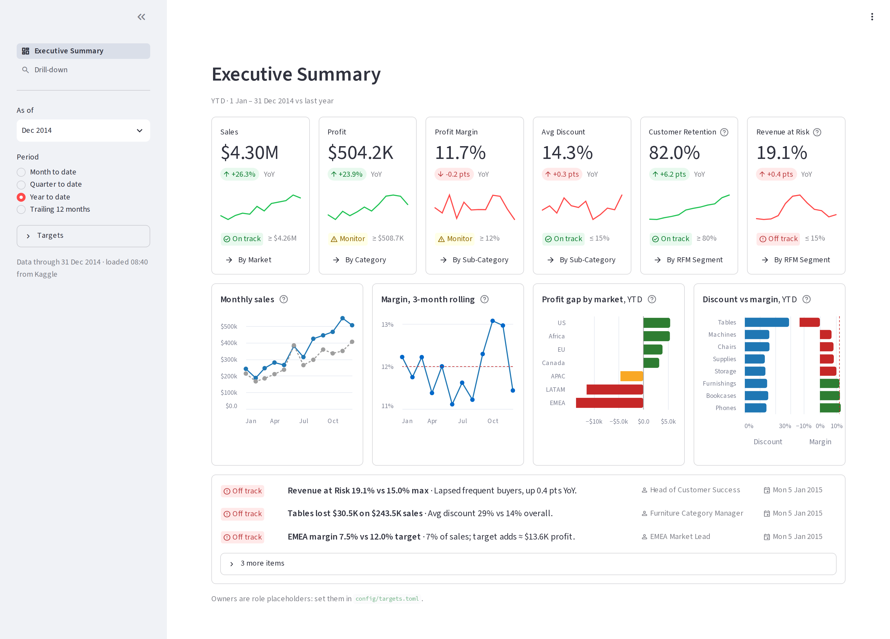
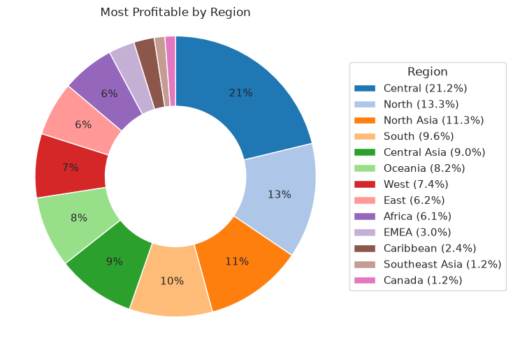
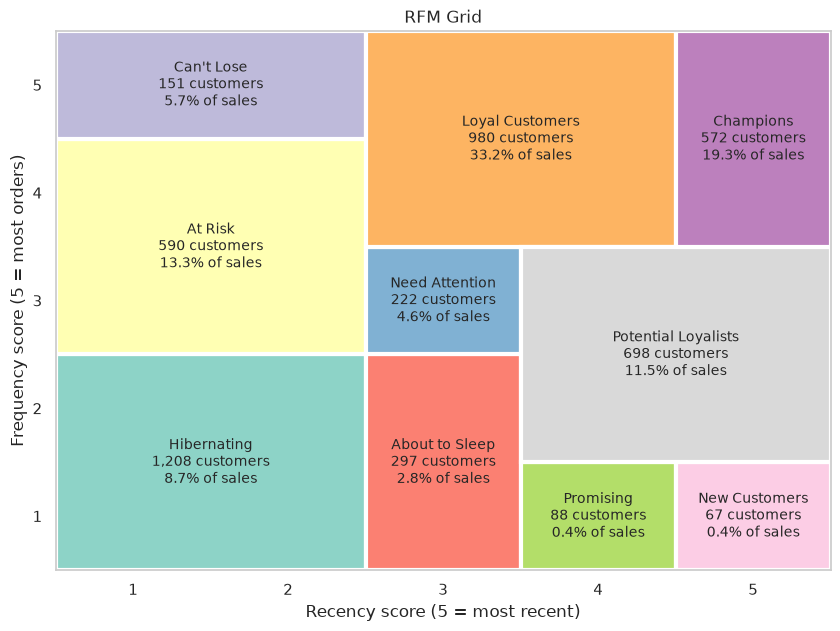
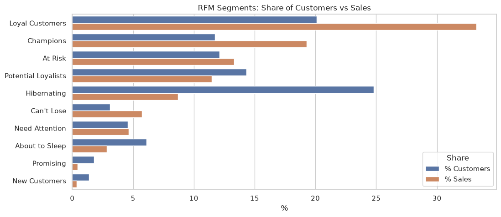
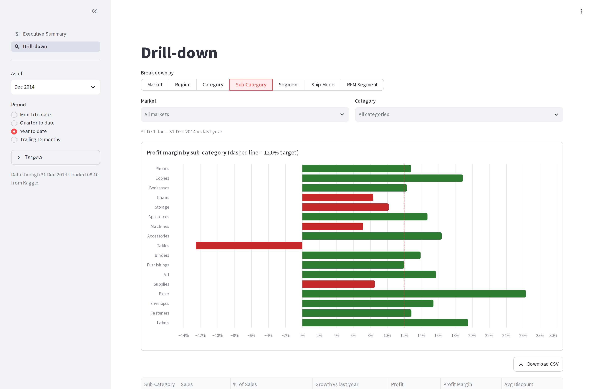

# Superstore executive summary

[](https://github.com/NathanWanjongkhum/super-store/actions/workflows/ci.yml)

An executive dashboard that answers *"are we on track, and what needs attention this week?"* for a global retailer. It covers 51K order lines from 2011–2014, from raw Kaggle data through analysis to a tested, deployable Streamlit app.

**[Live demo](https://REPLACE-ME.streamlit.app)** · [EDA notebook](notebooks/01-eda.ipynb) · [Metric dictionary](docs/metrics.md) · [Design decisions](docs/decisions.md)



## What it does

The page follows an executive summary layout: the most important numbers first, then the context, then what to do.

1. **Six KPI cards.** Sales, profit, margin, discount, customer retention and revenue at risk. Each card shows the value, the change vs last year, a 12-month sparkline, and a green, yellow or red status against a target.
2. **Four trend charts.** Sales vs last year, rolling margin, profit gap by market, and discount vs margin. These show *why* a number is where it is.
3. **Action items.** Generated from the data, each with what is off track, why it matters, who owns it, and when to review it.

A drill-down page breaks every KPI down by market, region, category, segment or customer segment, with CSV export. The sidebar switches the view between month, quarter, year to date and trailing 12 months, as of any month from Dec 2012 to Dec 2014, and lets you adjust targets to explore what-if scenarios.

## Exploratory analysis

The [EDA notebook](notebooks/01-eda.ipynb) is where the dashboard's questions came from. It works through the data in four steps:

1. **Profiling and cleaning.** The Order Date and Ship Date columns turned out to be corrupted (every value is `00:00.0`), so the loader rebuilds a week-accurate order date from the year and week number. The notebook also checks for duplicates (ignoring the per-row ID), confirms there are no missing values, and drops a constant "record count" column.
2. **Product mix.** Office Supplies makes up 61% of order lines; Binders, Storage and Art are the most frequent sub-categories.
3. **Profitability by customer segment and region.** Consumer, Corporate and Home Office orders earn almost the same average profit ($28–30 per line), so segment isn't what drives margin. Profit is spread across 13 regions, led by Central (21%).
4. **RFM customer segmentation.** Every customer is scored 1–5 on recency, frequency and monetary value, then grouped into 10 segments (Champions, Loyal Customers, At Risk, and so on), shown on an RFM grid. Loyal Customers and Champions are a third of customers but over half of sales. That analysis became the dashboard's customer-health KPIs.

<p align="center">
  
</p>

<p align="center">
  
  
</p>

The discount finding below came from following up on the margin question that the notebook raised.

## What the data shows

- **Sales grew 26% in 2014, but margin slipped to 11.7%.** Profit grew more slowly than sales.
- **Discounting is where the profit goes.** Orders with no discount earn a 25% margin, and orders discounted more than 20% lose money on average.
- **Tables is sold at a loss.** It earns 23% at full price, but over half of its orders are discounted more than 20%, for a −12.5% margin overall.
- **Two markets, EMEA and LATAM, miss the margin target** by about $25K of profit combined.
- **Customers are coming back** (82% retention, up 6 points), but 19% of sales sits with frequent buyers who have gone quiet.



## How it's built

| | |
|---|---|
| **Analysis** | Jupyter EDA with pandas, matplotlib and seaborn; RFM customer segmentation; cleaning a dataset with corrupted date columns (rebuilt from year + week number) |
| **App** | Streamlit multipage app with Altair charts, cached data loading, and a shared sidebar state |
| **Design** | Inverted-pyramid executive layout, status colors with labels, no pie charts or dual axes |
| **Engineering** | Business logic in a typed, tested Python package, separate from the UI; targets and owners in a config file validated with pydantic, which also sets the sidebar inputs' limits |
| **Reliability** | Data validation on load, an offline snapshot fallback, a "data through" freshness line, and friendly error messages |
| **Testing & CI** | 93 pytest tests (unit tests for the metrics, plus app smoke tests for every view); ruff linting; ty type checking; GitHub Actions on Python 3.12 and 3.14 |
| **Automation** | A weekly digest script that formats the action items as an email and a Slack message. It runs in **dry-run mode**: it prints what it would send and never contacts a mail server or Slack |

## Run it locally

Requires [uv](https://docs.astral.sh/uv/). The dataset downloads from Kaggle automatically; no account needed.

```sh
uv sync
PYTHONPATH=src uv run streamlit run app/dashboard.py   # dashboard
uv run pytest                                         # tests
PYTHONPATH=src uv run python scripts/weekly_digest.py --as-of 2014-12   # dry-run digest
```

## Notes

- **Demo targets and owners.** The dataset has no targets, so the defaults (in `config/targets.toml`) are set just above historical performance, and the owners are placeholder roles.
- **Customer counts.** The dataset gives each customer a separate ID per market, so 795 people appear as 4,873 customers.
- **Technical documentation.** The [metric dictionary](docs/metrics.md) gives every formula and its source, and the [design decisions](docs/decisions.md) cover the data quirks, the trade-offs, and how it's deployed.
